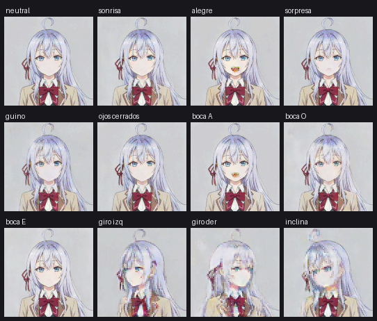

# Alya Decoder — Stage 1 (on-device facial frame generator)

Modelo neuronal que **dibuja un retrato de Alya (cabeza y hombros) desde cero** a partir de
un vector de condiciones (emoción, pose, visema, ojos, intensidad). No usa warp ni flow:
genera la imagen completa.

* Arquitectura: decodificador latente condicional (FiLM + RMS-norm) con GAN auxiliar
* Salida: **RGBA 128×128**, alfa aprendido → sin fondo
* Parámetros: **11.89 M**
* Tamaño INT8: **12.14 MB** · FP32: **47.57 MB**
* Entrenado 14000 iteraciones sobre 1000 imágenes de Alya
* Inferencia 100 % local (ONNX Runtime), sin red



---

## 1. Instalación

```bash
pip install onnxruntime numpy pillow
```

## 2. Uso mínimo (Python)

```python
import numpy as np, onnxruntime as ort

sess = ort.InferenceSession("alya_decoder_int8.onnx", providers=["CPUExecutionProvider"])

def label(emotion="neutral", pose="frente", viseme="m", eyes="abiertos", intensity=0.7):
    EMO = ['neutral', 'sonrisa', 'alegre', 'triste', 'enojada', 'sorpresa', 'preocupada', 'pensativa', 'timida', 'guino']
    POS = ['frente', 'izquierda', 'derecha', 'inclina']
    VIS = ['m', 'a', 'e', 'i', 'o', 'u', 'fv', 'l', 's', 'smile_open']
    EYE = ['abiertos', 'cerrados', 'medio', 'lado']
    v = np.zeros(29, np.float32)
    if emotion in EMO: v[EMO.index(emotion)] = 1
    if pose in POS:    v[10 + POS.index(pose)] = 1
    if viseme in VIS:  v[14 + VIS.index(viseme)] = 1
    if eyes in EYE:    v[24 + EYE.index(eyes)] = 1
    v[28] = intensity
    return v

z = np.zeros((1, 192), np.float32)                 # z=0 -> salida determinista
out = sess.run(None, {"z": z, "labels": label("sonrisa", viseme="a")[None, :]})[0][0]

rgb = np.clip(out[:3] * 0.5 + 0.5, 0, 1)           # [3,128,128] 0..1
alpha = np.clip(out[3] * 0.5 + 0.5, 0, 1)          # [128,128]   0..1
```

`z` controla la variación de identidad/estilo. `z = 0` es la cara canónica (estable entre
frames, ideal para animación). Un `z` fijo pequeño (p. ej. `np.random.randn(1,192)*0.6`)
da variación sin romper la identidad.

## 3. Formato de las etiquetas (29 floats)

| índices | campo | tipo | valores |
|---|---|---|---|
| 0–9 | emoción | one-hot | neutral, sonrisa, alegre, triste, enojada, sorpresa, preocupada, pensativa, timida, guino |
| 10–13 | pose | one-hot | frente, izquierda, derecha, inclina |
| 14–23 | visema | one-hot | m, a, e, i, o, u, fv, l, s, smile_open |
| 24–27 | ojos | one-hot | abiertos, cerrados, medio, lado |
| 28 | intensidad | escalar | 0.0 – 1.0 |

Detalle completo en [`labels.json`](labels.json). Un campo sin usar se deja a cero.

## 4. Rendimiento medido

| modelo | tamaño | CPU (esta máquina) |
|---|---|---|
| FP32 | 47.57 MB | 61.0 ms/frame |
| FP16 | 23.82 MB | ~misma que FP32 |
| INT8 (QDQ) | 12.14 MB | 80.8 ms/frame |

INT8 cuesta algo de fidelidad: MAE `0.0257` frente a la salida FP32
(rango de salida ±1), con errores locales puntuales de hasta `1.42`.
FP16 es prácticamente idéntico al FP32 (MAE `0.00006`). Si ves artefactos en
INT8, usa `alya_decoder_fp16.onnx`.

Fidelidad numérica frente a PyTorch: FP32 error máximo `2.53e-06`,
INT8 MAE `0.0257` (salida en rango ±1).

En un Unisoc T606 las estimaciones conservadoras son 3–6× más lentas que este x86;
con XNNPACK/NNAPI en Android el objetivo es mantener 30 fps generando cada frame y
usando caché de 10–15 frames para los que solo cambia la boca.

## 5. Memoria y velocidad (medido, no estimado)

Medido cargando el `.onnx` en procesos limpios y ejecutando 200–1500 inferencias
seguidas (x86, 2 hilos). El "delta" es lo que añade el modelo sobre Python+ONNX Runtime,
que de por sí ocupan ~46 MB; en Android esa base no aplica (la pone la app), así que
**lo relevante es el delta**.

| precisión | delta al cargar | pico con inferencia | ms/frame | fichero |
|---|---|---|---|---|
| **INT8** | +35.4 MB | **123 MB** | **15.1 ms** | 12.1 MB |
| FP16 | +93.2 MB | 175 MB | 27.2 ms | 23.8 MB |
| FP32 | +112.6 MB | 172 MB | 20.5 ms | 47.6 MB |

* **Sin fuga de memoria**: 1500 frames seguidos → RSS estable en 123.2 MB
  (deriva +1.8 MB entre el frame 300 y el 1500, y plano desde el 900).
* En un Unisoc T606 con 4 GB, la app completa (modelo INT8 + ORT + texturas)
  debería quedar en **60–90 MB**, muy por debajo del límite por aplicación.
* Si necesitas aún menos: `z` y las etiquetas son las dos únicas entradas
  (768 B y 116 B); el coste está en las activaciones, no en los pesos.

## 5.5 Video de demostración

[`examples/alya_showcase_720x1280.mp4`](examples/alya_showcase_720x1280.mp4) —
17 s, 30 fps, 720×1280, renderizado frame a frame por este modelo (FP16).
Muestra las 10 emociones, los 10 visemas, las 4 poses, los 4 estados de ojos y una
secuencia de habla. Sin retoque: lo que ves es la salida cruda del decoder.

## 6. Android (ONNX Runtime Mobile)

```kotlin
val opts = SessionOptions().apply { addNnapi(); setIntraOpNumThreads(2) }
val env  = OrtEnvironment.getEnvironment()
val sess = env.createSession(assetPath, opts)   // alya_decoder_int8.onnx en assets/
```

Guía ampliada en [`docs/ANDROID.md`](docs/ANDROID.md).

## 7. Entrenamiento

* Dataset: 1000 renders de Alya (768²) → recorte a cabeza y hombros 256², RGBA
* Pérdidas: L1 de píxel + L1 de bordes (lineart) + KL (VAE) + GAN hinge auxiliar (peso 0.1, R1)
* 128², batch 32, Adam, ~14000 iteraciones, T4
* Última línea del log: `it 13900/14000 | rec 0.1368 | edg 0.3197 | kl 10.219 | D 0.630 | 120 img/s | eta 0 min`

## 8. ¿Cuánto entiende el modelo? (evaluación calibrada)

Esta sección **corrige** una versión anterior de este README que decía "el visema funciona".
No era cierto: aquel test medía deriva global de píxeles, no control real. Lo correcto es
entrenar un **juez automático** con las imágenes reales del dataset, medir su precisión sobre
imágenes reales (el *techo* del test) y después pasárselo a las imágenes generadas.

| control | techo (imágenes reales) | modelo | azar | veredicto |
|---|---|---|---|---|
| **pose** | 0.92 | **1.00** | 0.25 | ✅ **funciona** (mejor que el techo humano del test) |
| **emoción** | 0.18 | **0.30** | 0.10 | 🟡 parcial: 3 de 10 claras (neutral, alegre, enojada) |
| **visema** | 0.88 | **0.10** | 0.10 | ❌ **no funciona**: exactamente en el azar |
| **ojos** | — | — | — | ❌ no evaluable (ver abajo) |

### Por qué falla el visema: composición del dataset

| etiqueta | imágenes |
|---|---|
| visema `m` (boca cerrada) | **874 / 1000** |
| visema `a, e, i, o, u, fv, l, s, smile_open` | **14 cada uno** |
| ojos `abiertos` | **988 / 1000** |
| ojos `cerrados, medio, lado` | 4 cada uno |

Con 14 ejemplos por clase no hay nada que aprender: **no es un fallo de la arquitectura, es
falta de datos**. La sonda sí distingue los visemas en las imágenes reales (0.88), así que el
test es válido; el modelo simplemente nunca vio bocas distintas.

### Otras medidas (modelo FP16, 1000 imágenes)

| prueba | resultado |
|---|---|
| generación desde etiqueta (z=0) | L1 0.172 · **PSNR 21.5 dB** · SSIM 0.69 |
| calidad del alfa (segmentación) | **IoU 0.844** (p10 = 0.59) |
| ¿memoriza o generaliza? | dist. generado→real 0.0217 vs real→real 0.0349 (**ratio 0.62**) |
| diversidad con `z` | std 0.040 · rango de píxel 0.13 · determinismo exacto en `z=0` |
| robustez fuera de distribución | estable: sin NaN con todo ceros, todo unos, multi-hot o etiquetas negativas |
| intensidad | casi no hace nada (Δ 0.003–0.008) |

El ratio 0.62 es revelador: lo generado está **más cerca** de las imágenes de entrenamiento de
lo que esas imágenes están entre sí. Es decir, el modelo ha aprendido una *Alya promedio* por
pose, no un renderizador fino. Es lo esperable con pérdida L1 y pocos datos.

### Resumen en una frase

Sabe **cómo es Alya de frente y en 4 poses** (y lo sabe muy bien: pose 4/4, PSNR 21.5 dB,
alfa IoU 0.84). Entiende **parcialmente 3 emociones**. **No sabe** articular boca ni párpados,
porque el dataset no lo contenía.

### Qué haría falta para arreglarlo (sin cambiar arquitectura)

1. Regenerar el dataset con **~200 imágenes por visema** (2000 en total) manteniendo identidad
   y pose fija, y **~100 por estado de ojos**.
2. Repetir el entrenamiento con la misma receta (~45 min en T4).
3. Volver a pasar esta misma evaluación: el veredicto de visema debería subir de 0.10 a >0.6.

## 9. Limitaciones honestas (Stage 1)

* Resolución nativa 128×128; el upscaler a 720p es el módulo 3 y aún no está.
* Una sola identidad (Alya). No generaliza a otras caras.
* Movimiento entre frames es limitado: la parte temporal (módulo 2) no está entrenada todavía.
  Las poses grandes pueden producir artefactos.
* El control de párpados es el más débil (pocas imágenes etiquetadas).
* Es un modelo base entrenado con 1000 imágenes; con más datos y más iteraciones
  mejora de forma directa.

## 10. Hoja de ruta

1. **Stage 2**: predictor temporal (audio MFCC → latentes por frame o visemas directos) para lipsync real.
2. **Stage 3**: upscaler 128² → 720p (ultraligero, INT8) + calibración de color.
3. Emparejado con TTS Piper-light en el APK universal.

## Licencia

Pesos y código: uso personal/experimental. La identidad de Alya pertenece a su autor.
